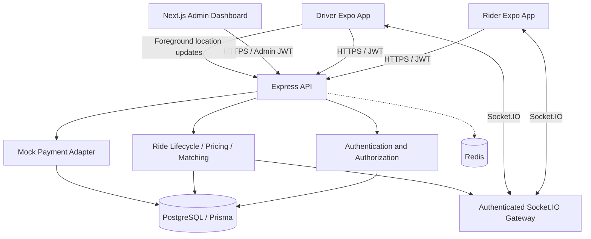
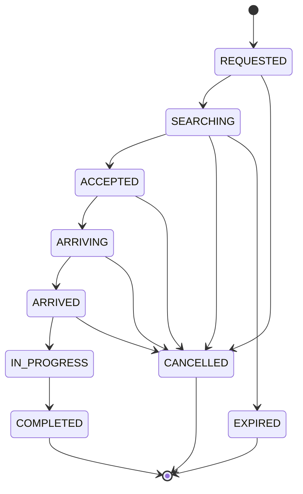

# System Architecture Diagram

The backend is a modular monolith with distinct rider, driver and administrative clients. PostgreSQL is the durable system of record. Redis is available for operational coordination, but the current Socket.IO deployment is single-instance.

## Ride lifecycle

A rating is a separate record that a rider may submit after a ride reaches `COMPLETED`. It is not a new value of the `RideStatus` enum.

## Trust boundaries

- All financial amounts and state changes are calculated/validated on the server.
- JWT role claims authorize API endpoints; Socket.IO rooms require participant checks.
- PostgreSQL is the authority for ride ownership, trip state and payment records.
- Driver assignment is protected by conditional writes and a partial unique index. Operationally robust dispatch still needs centralized queueing, retries and observability.
- Do not store long-term location trails without a documented retention policy and user consent.

See [architecture.md](architecture.md), [api.md](api.md), and [security.md](security.md).
